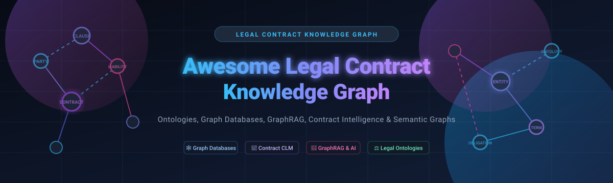

  

# ⚖️ Awesome Legal Contract Knowledge Graph 🕸️✨

  <strong>🚀 A curated directory of software, enterprise cloud platforms, graph databases, semantic ontologies, and GraphRAG toolkits for building and querying Legal &amp; Contract Knowledge Graphs.</strong>

---

## 📑 Table of Contents

- [📊 Sector Overview & Market Dynamics](#-sector-overview--market-dynamics)
- [🏢 SaaS & Hosted Platforms](#-saas--hosted-platforms)
- [💻 Open-Source Software & Toolkits](#-open-source-software--toolkits)
- [🔍 Key Architectural Dimensions](#-key-architectural-dimensions)
- [🌟 Star History](#-star-history)
- [💖 Support & Community](#-support--community)
- [🤝 Contributing](#-contributing)
- [📜 License](#-license)

---

## 📊 Sector Overview & Market Dynamics

The global Knowledge Graph and Enterprise Graph Analytics market is estimated at **$1.1 billion to $1.3 billion in 2024**, projected to reach **$7.0 billion to $8.3 billion by 2030** at a compound annual growth rate (CAGR) of ~34%–36%, driven by generative AI adoption, enterprise GraphRAG architectures, and complex contract obligation modeling. 📈

The sector exhibits a **moderately concentrated infrastructure tier** dominated by hyperscalers and specialized graph pioneers (Amazon Neptune, Neo4j), coexisting with a **highly fragmented application and semantic tooling landscape** where vertical legal tech platforms (Icertis Vera) and specialized graph engines compete across domain ontologies and multi-modal contract intelligence. 🌐

---

## 🏢 SaaS & Hosted Platforms

The following hosted platforms and commercial SaaS databases provide graph storage, semantic inference, entity extraction, and knowledge graph construction for complex legal agreements, corporate filings, and contract lifecycles. Entries are sorted in descending order of vendor scale (company valuation / market capitalization). 🏆

| Software / Platform | 💰 Vendor Valuation / Scale | 🏷️ Starting Pricing | 🎁 Free Tier / Trial Allowance | 📝 Overview & Contract Knowledge Graph Capabilities |
| :--- | :--- | :--- | :--- | :--- |
| [Amazon Neptune](https://aws.amazon.com/neptune/) | **$1.9 Trillion** *(Market Cap)* | **$0.10/hour** provisioned instance (`db.t3.medium`) or **$0.01/hour** baseline storage | **30-day free trial** with 750 hours of `db.t3.medium`/`db.t4g.medium`, 1 GB graph storage, and 10M I/O requests | Fully managed graph database supporting property graphs (Apache TinkerPop Gremlin, openCypher) and RDF/SPARQL to link clauses, parties, parent companies, and contract amendments. |
| [Icertis Vera Knowledge Graph](https://www.icertis.com/) | **$5.0 Billion** *(Private Valuation)* | **$2,000.00/month** enterprise starting baseline (multi-user CLM deployment) | **30-day guided interactive trial sandbox** upon consultation with sample legal contract portfolio analysis | Dedicated legal contract intelligence engine mapping relationships between negotiated terms, commitments, obligations, and systemic legal risks across millions of contract clauses. |
| [Neo4j AuraDB](https://neo4j.com/cloud/platform/aura-graph-database/) | **$2.0 Billion** *(Private Valuation)* | **$65.00/month** (AuraDB Professional instance) | **Free AuraDB Free tier: 1 instance** with up to 50K nodes and 175K relationships forever (no credit card required) | Fully managed cloud native graph database providing Cypher query processing, native vector indexes, and GraphRAG integrations to link interconnected legal terms and corporate governance trees. |
| [TigerGraph Cloud (Savanna)](https://www.tigergraph.com/cloud/) | **$1.0 Billion** *(Private Valuation)* | **$0.25/hour** provisioned compute (approx. $180.00/month baseline cluster) | **Savanna Free Plan: $0/month** developer workspace with TG-4 instance allocation and single-workspace quota | Enterprise distributed graph database featuring GSQL query language, parallel processing, and deep multi-hop relationship querying across complex corporate ownership and supplier contracts. |
| [Stardog Cloud](https://www.stardog.com/) | **$800 Million** *(Private Valuation)* | **$1,500.00/month** starting standard cloud deployment (annual commitment) | **Free Cloud Tier: 1M edges** and 3 databases forever + **30-day full enterprise trial** via AWS Marketplace | Enterprise Knowledge Graph platform combining semantic web standards (OWL, RDF, SPARQL) with machine reasoning to link disparate legal schemas, compliance obligations, and clause taxonomies. |
| [Ontotext GraphDB](https://www.ontotext.com/products/graphdb/) | **$500 Million** *(Graphwise Group Valuation)* | **$1,200.00/month** entry managed cloud / **$0/hr BYOL AMI** (plus underlying Azure/AWS VM compute) | **GraphDB Free Edition: $0** perpetual developer license (up to 2 concurrent queries) + **14-day cloud evaluation** | Semantic RDF graph database engine featuring inferencing, text-to-graph linking, and full-text faceted search ideal for regulatory taxonomies and multi-jurisdictional legal definitions. |
| [ArangoGraph Insights Platform](https://cloud.arangodb.com/) | **$350 Million** *(Private Valuation)* | **$0.20/hour** (approx. $144.00/month baseline managed cluster) | **14-day free cloud trial** with full access to managed cluster resources and vector search (no credit card required) | Multi-model graph database engine combining property graphs, document stores (JSON), and full-text search into unified AQL queries to model contracts as hierarchical documents and graphs. |
| [Diffbot Knowledge Graph](https://www.diffbot.com/products/knowledge-graph/) | **$250 Million** *(Private Valuation)* | **$299.00/month** (Startup Plan covering 250,000 extraction credits) | **Free Plan: 10,000 credits/month** forever with 5 calls/minute rate limit (no credit card required) | Web-scale automated knowledge graph extracting corporate structures, executive leadership, legal controversies, parent companies, and contract relationships from billions of public entities. |
| [Memgraph Cloud](https://memgraph.com/cloud) | **$150 Million** *(Series A Valuation)* | **$0.09/hour** (approx. $65.00/month for 1 GB RAM cloud instance) | **14-day free trial** with up to 2 GB RAM managed AWS instance | High-performance in-memory graph database with Cypher query compatibility, optimized for streaming contract event data, dynamic covenant monitoring, and real-time GraphRAG legal query execution. |
| [Graphlit](https://www.graphlit.com/) | **$20 Million** *(Seed Stage)* | **$49.00/month** (Hobby Plan baseline before winding down self-serve) | **Free tier: 100 credits and 1GB storage** forever during active service | Serverless platform for building knowledge graphs and vector embeddings directly from ingested legal contracts, court filings, audio hearings, and unstructured PDF documents. |

---

## 💻 Open-Source Software & Toolkits

Open-source graph databases, semantic ontology frameworks, and GraphRAG pipelines allow legal tech engineers to build sovereign, air-gapped contract intelligence platforms without vendor lock-in. Entries are sorted in descending order of GitHub star count. 🌟

| Project & Repository | ⭐ GitHub Stars | 🛠️ Primary Language / Ecosystem | 📖 Description & Legal Contract Graph Use Case |
| :--- | :--- | :--- | :--- |
| [Microsoft GraphRAG](https://github.com/microsoft/graphrag) |  | Python | Modular graph-based Retrieval-Augmented Generation (RAG) system using LLMs to extract entity networks and detect community clusters across voluminous contract corpora and legal agreements. |
| [SurrealDB](https://github.com/surrealdb/surrealdb) |  | Rust | Multi-model database integrating graph relations, document storage, and vector search with SurrealQL, enabling direct pointer-based traversals across contract definitions and clause dependencies. |
| [Dgraph](https://github.com/dgraph-io/dgraph) |  | Go | Horizontally scalable, distributed GraphQL-native graph database with low latency and ACID transactions, suitable for multi-tenant enterprise contract registry backends. |
| [Neo4j Community Edition](https://github.com/neo4j/neo4j) |  | Java | The benchmark open-source property graph database implementing Cypher queries and index-free adjacency to traverse party relationships, boilerplate clauses, and parent-child amendment structures. |
| [Cayley](https://github.com/cayleygraph/cayley) |  | Go | Open-source graph database inspired by Google Knowledge Graph and Freebase, supporting Gizmo and GraphQL-style queries for fast local semantic entity querying in legal compliance software. |
| [ArangoDB Community Edition](https://github.com/arangodb/arangodb) |  | C++ | Native multi-model database engine allowing legal documents to be indexed as JSON contracts while modeling interrelated obligations, governing jurisdictions, and parties as directed edges. |
| [Nebula Graph](https://github.com/vesoft-inc/nebula) |  | C++ | Distributed, linearly scalable graph database engineered to handle super-large datasets with tens of billions of vertices, ideal for cross-institutional legal entity resolutions and corporate registries. |
| [Neo4j LLM Graph Builder](https://github.com/neo4j-labs/llm-graph-builder) |  | Python, JavaScript | Automated pipeline converting unstructured documents (PDF contracts, SEC filings, leases) into structured Neo4j knowledge graphs using LLMs and domain ontologies. |
| [Memgraph](https://github.com/memgraph/memgraph) |  | C++ | In-memory, Cypher-compatible graph database built for real-time analytics, high-frequency contract risk event processing, and low-latency GraphRAG entity traversal. |
| [Apache HugeGraph](https://github.com/apache/hugegraph) |  | Java | Highly scalable graph database system supporting Apache TinkerPop Gremlin standard, capable of storing billions of relations across complex enterprise contract archives. |
| [RDFLib](https://github.com/RDFLib/rdflib) |  | Python | Essential Python semantic web toolkit providing parsers, serializers, and in-memory triplestores for working with RDF, RDFS, OWL, and SPARQL legal ontologies (e.g., LKIF, FIBO). |
| [Aleph](https://github.com/alephdata/aleph) |  | Python, JavaScript | Investigative search and cross-referencing platform powered by FollowTheMoney entity-relationship models, widely used to map contracts, beneficial ownership, and sanctions networks. |
| [Apache TinkerPop](https://github.com/apache/tinkerpop) |  | Java | Open-source graph computing framework and standard specification for the Gremlin graph traversal language, decoupling legal knowledge graph queries from underlying storage backends. |
| [Apache Jena](https://github.com/apache/jena) |  | Java | Java framework for Semantic Web and Linked Data applications, offering TDB triplestore, rule-based inference engines, and SPARQL 1.1 querying for complex legal logic verification. |
| [spaCy Layout](https://github.com/explosion/spacy-layout) |  | Python | Extension for spaCy designed to parse PDF and Word contract structures into semantic tokens, linking visual layouts and section headers directly into document node graphs. |
| [Fluree](https://github.com/fluree/db) |  | Rust, Clojure | Immutable, cryptographically verifiable graph database using W3C semantic graph standards (JSON-LD), delivering tamper-evident audit trails for contract modifications and executions. |
| [Graphlit Python SDK](https://github.com/graphlit/graphlit-client-python) |  | Python | Python client library for automating ingestion pipelines, text chunking, and semantic knowledge graph synthesis from legal agreements and regulatory briefs. |

---

## 🔍 Key Architectural Dimensions

When building a Knowledge Graph for legal agreements and contract lifecycle intelligence, evaluate tools across these foundational capabilities: 🧭

1. **🕸️ Property Graph vs. Semantic RDF**: Property graphs (Neo4j, Memgraph) excel at high-performance traversal, pattern matching, and GraphRAG. Semantic RDF graphs (Stardog, GraphDB, Jena) provide formal reasoning, OWL ontologies, and W3C open data interoperability.
2. **🧠 GraphRAG & Entity Disambiguation**: Combining graph traversals with vector search prevents LLM hallucination when analyzing clauses by constraining retrieval to verified contract entities, signatories, and governing law links.
3. **🔄 Clause Hierarchy & Amendment Lineage**: Contracts are non-linear; an effective legal graph must model base master services agreements (MSAs), schedules, statements of work (SOWs), amendments, and overrides as versioned, directed subgraphs.
4. **🔒 Cryptographic Immutability & Audit Trails**: Legal graphs require strict data provenance to verify when a clause was updated, which legal team member executed a waiver, and how obligation deadlines propagate through contract lifecycles.
5. **🛡️ On-Premises & Air-Gapped Security**: Contract data involves highly sensitive commercial terms, IP rights, and PII. Self-hosted and open-source models ensure complete data sovereignty and regulatory compliance.

---

## 🌟 Star History

---

## 💖 Support & Community

If you find this curated legal tech directory helpful:

- ⭐ **Star this repository** to show your support and help others discover it!
- 💬 **Join our community**: Connect on [Discord](https://discord.gg/jc4xtF58Ve) to discuss LegalTech, GraphRAG, and knowledge graphs.
- ☕ **Sponsor & Donate**: Support ongoing curation and open-source research via [GitHub Sponsors](https://github.com/sponsors/ishandutta2007).

---

## 🤝 Contributing

Contributions are warmly welcomed! Please read the contribution guidelines:

1. Fork the repository and create your feature branch (`git checkout -b feature/cool-graph-tool`).
2. Verify that your addition has relevant utility for legal, contract, or enterprise knowledge graph applications.
3. Ensure open-source additions include clean documentation, licensing info, and active repository status.
4. Submit a Pull Request with a clear description of the project.

---

## 📜 License

Distributed under the MIT License. See [LICENSE](LICENSE) for more information.
